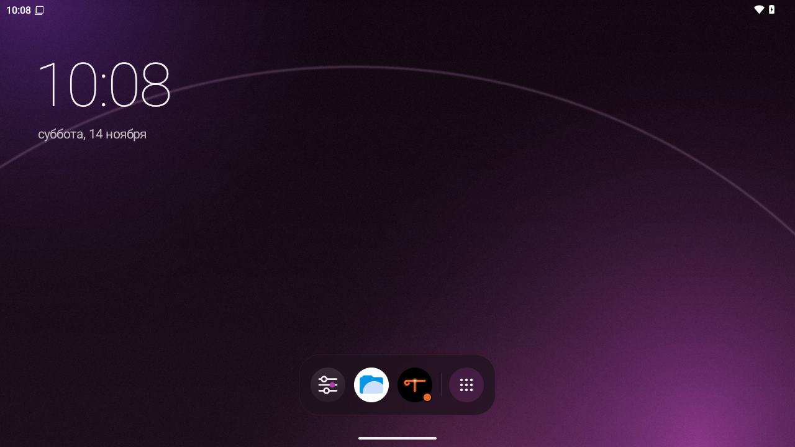
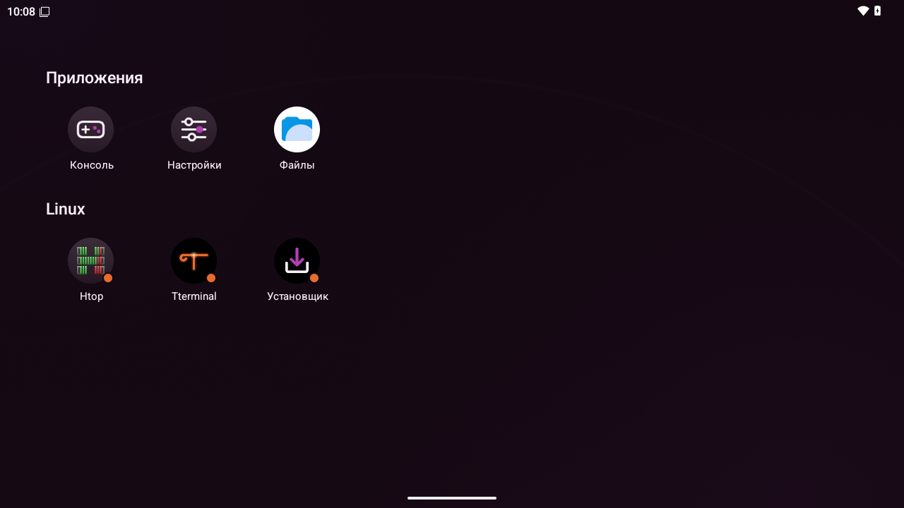

  

<h1 align="center">TriggerOS</h1>

  <b>Android 15 + настоящий Linux на одном экране</b> 
  <b>Android 15 + real Linux on one screen</b>

  
  
  
  

  <a href="#русский">Русский</a> · <a href="#english">English</a>

  
  

---

## Русский

**TriggerOS** — неофициальная система для консоли Nintendo Switch (модель OLED), основанная на LineageOS 22.2 (switchroot).
Скорость и приложения Android, а рядом — полноценная Ubuntu: Linux-программы открываются в обычных окнах Android,
как в ChromeOS. Без перезагрузки и без второго рабочего стола.

### Что внутри
- **Свой интерфейс:** главный экран, меню программ и «Недавние» в палитре TriggerOS, свои значки, своя анимация загрузки.
- **Linux-программы в окнах:** собственный Wayland-композитор `trigwm`; окна Linux живут в списке задач рядом с Android.
- **Tterminal:** терминал в стиле «16 бит» (пиксельный шрифт Terminus, палитра TriggerOS); строка ввода всегда над клавиатурой.
- **Установщик:** выбираешь пальцем браузер, офис, GIMP, Krita, mpv и другие — и они ставятся сами и появляются в меню.
- **Ядро:** своя сборка L4T 4.9 — zram с выгрузкой, планировщик питания GPU, правки дисплея.
- **«Консоль»:** настройки джойконов и консоли на языке системы (RU/EN).

### Установка
📖 **[Инструкция по установке (RU)](docs/INSTALL.ru.md)**

Коротко: hekate → разметить SD-карту под Android → скопировать загрузочный комплект → прошить через recovery (`adb sideload`).
Установка на внутреннюю память (eMMC) тоже возможна — см. раздел в инструкции.

### Статус
`0.7.1` — первый публичный релиз. Это бета: возможны ошибки — пишите в [Issues](https://github.com/Ttriggeredbot/TriggerOS/issues).

---

## English

**TriggerOS** is an unofficial OS for the Nintendo Switch (OLED model) based on LineageOS 22.2 (switchroot).
Android speed and apps, plus a full Ubuntu next to it: Linux programs open in regular Android windows,
like on ChromeOS. No reboot, no second desktop.

### What's inside
- **Own interface:** home screen, app drawer and Recents in the TriggerOS palette, own icons and boot animation.
- **Linux apps in windows:** our own Wayland compositor `trigwm`; Linux windows sit in the task list next to Android apps.
- **Tterminal:** a "16-bit" terminal (Terminus pixel font, TriggerOS palette); the input line always stays above the keyboard.
- **Installer:** pick a browser, office suite, GIMP, Krita, mpv and more with your finger — they install and show up in the menu.
- **Kernel:** our own L4T 4.9 build — zram writeback, GPU power gating, display fixes.
- **Console app:** Joy-Con and device settings in the system language (EN/RU).

### Installation
📖 **[Installation guide (EN)](docs/INSTALL.en.md)**

In short: hekate → partition the SD card for Android → copy the boot kit → flash via recovery (`adb sideload`).
Installing to internal storage (eMMC) is also possible — see the guide.

### Status
`0.7.1` is the first public release. It is a beta: bugs are possible — please report them in [Issues](https://github.com/Ttriggeredbot/TriggerOS/issues).

---

TriggerOS is not affiliated with, endorsed or sponsored by Nintendo, Google, Canonical, NVIDIA or the LineageOS project.
"Nintendo Switch" is a trademark of Nintendo; it is used here only to describe hardware compatibility.
The release contains no Nintendo firmware, keys or copyrighted Nintendo content.
See <a href="AUTHORS.md">AUTHORS.md</a> for credits and <a href="NOTICE.md">NOTICE.md</a> for licenses and sources.

